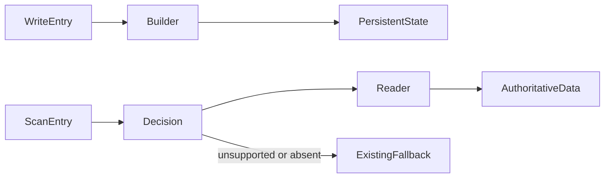

# Database Design Confirmation

用于较大型数据库设计的三阶段确认。目标是让用户在代码实现前逐层确认边界、整体机制和具体契约，避免只确认“大致范围”后直接编码，造成实现与预期偏离。

本 skill 适用于数据库内核、存储、索引、执行器、优化器、事务、复制、恢复、分布式执行、后台任务、catalog 和扩展机制，不绑定某个产品或模块。

## 基本规则

严格按以下顺序推进：

```text
范围确认 -> 框架确认 -> 接口确认 -> 原任务的下一步
```

- 每个阶段开始时，主动列出本阶段需要确认的内容，不等用户逐项追问。
- 每个阶段完成后，明确记录确认结果，并立即提示、展开下一阶段。
- 不因用户回复“继续”就默认确认尚未确认的关键决定。“继续”表示继续当前流程。
- session 中用户已经明确表达并且未被后续消息推翻的结论，视为已确认，不重复询问。
- 用户最新的修正覆盖较早结论。简短纠正、否定、偏好和边界声明同样是设计输入。
- Agent 曾经提出但用户没有确认的内容只能标为 `当前提案`，不能写成既定结论。
- 对低影响且已有充分源码证据的实现细节可以给出推荐默认值；涉及持久化、兼容性、SQL 语义、并发、恢复或跨模块职责的决定必须显式呈现。
- 在接口确认完成前，不开始大规模功能实现。允许进行只读源码调查、最小可编译探针或用户明确要求的框架骨架；必须清楚标明其不是完整实现。
- 不把确认流程变成固定问卷。只保留会影响当前设计、代码边界或验收标准的内容。

## 会话回溯

启动或恢复流程时，先整理当前 session 中与该设计有关的用户消息，尤其是连续追问和纠正。不要只总结最后一条需求。

将历史输入归入四类：

| 状态 | 含义 |
|---|---|
| `已确认` | 用户明确选择、认可或给出约束 |
| `当前提案` | Agent 根据源码和约束提出，等待确认 |
| `待确认` | 仍会实质影响设计或实现的开放问题 |
| `已否决` | 用户明确不接受的方向，后续设计不得悄悄引入 |

回溯时重点提取：

- 用户追问暴露的隐含要求；
- 被否决的方案及否决原因；
- 用户对复杂度、抽象层次和可见性的偏好；
- 已确认的数据归属、执行位置和模块边界；
- 仍未回答或只得到推测性回答的问题；
- 原始任务与最新修正之间的变化。

先用当前源码、维护文档和历史记录核实事实。明确区分 `源码事实`、`用户结论`、`设计提案` 和 `待验证假设`。不要把旧文档、函数名或已有构建产物当作运行时行为证明。

如果 session 已经完成某个阶段，简短重建该阶段的确认基线，然后从第一个未完成阶段继续，不重新开始。

## 阶段一：范围确认

范围确认回答“做什么、在哪里做、明确不做什么”。主动整理以下与当前任务有关的内容：

- 要解决的实际问题、触发条件和目标行为；
- 影响的数据库对象及粒度：cluster、database、relation、partition、run、page、tuple、index 等；
- 涉及的角色和节点：coordinator、segment、storage node、standby、background worker 等；
- 写入、读取、DDL、维护、转换、恢复中哪些路径属于范围；
- 正确性、性能和可观测性目标；
- catalog、planner、executor、storage format、WAL/replication 是否允许修改；
- 旧数据、滚动升级、混合版本、缺失结构和 fallback 的兼容边界；
- 明确排除的能力和被用户否决的方案；
- 验收结果，以及原型、第一版和完整版本的边界。

范围确认输出应包含：

1. 一段问题和目标描述；
2. `已确认`、`当前提案`、`待确认`、`已否决` 四类条目；
3. 明确的 in-scope/out-of-scope；
4. 会改变代码量或架构方向的少量待确认问题，并给出推荐选择及影响；
5. 一份可作为后续阶段基线的范围定义。

不要在此阶段陷入类名和函数签名。可以指出预期涉及的子系统，但不提前锁死接口。

当范围已确认时，主动提示：

```text
范围已确认。下一步进入框架确认：需要确认组件职责、读写流程、状态生命周期以及失败和兼容路径。
```

随后直接给出框架确认内容，不等待用户再次说“继续”。

## 阶段二：框架确认

框架确认回答“系统由哪些部分协作、状态如何流动”。它必须同时覆盖读流程和写流程；再根据设计补充 DDL、维护、compaction、复制、恢复或升级流程。

主动确认：

- 组件划分和每个组件的单一职责；
- 入口、决策位置和调用方向；
- 数据和 metadata 的所有权、存放位置及生命周期；
- 创建、写入、发布、读取、失效、重建、清理的状态转换；
- authoritative data 与 accelerator/cache/summary 的关系；
- 事务边界、MVCC、锁、并发写入和 abort 行为；
- WAL、redo、checkpoint、replication 和 crash recovery 中的职责；
- coordinator/segment 或其他分布式角色如何分工，决定在哪个节点作出；
- 缺失、不支持、旧版本、部分完成、损坏时的 fallback 或错误策略；
- 与现有模块的复用点，以及明确不引入的抽象。

输出一张紧凑的组件图或类图，以及最短但完整的关键流程。例如：



图中的名称应来自当前设计或源码。未知处使用职责名，避免为了画图提前发明类。

框架阶段必须列出至少这些流程的职责链：

- 正常写入及发布；
- 正常读取及最终正确性校验；
- fallback；
- 失败/abort/recovery；
- 与旧数据或相邻存储形态之间的转换。

对每个组件说明“负责什么”和“明确不负责什么”。优先使用现有模块和生命周期；新增抽象必须说明它消除的实际复杂度。

当框架已确认时，主动提示：

```text
框架已确认。下一步进入接口确认：需要把组件边界落实为关键结构、函数契约、状态与所有权规则，并逐条走通读写流程。
```

随后直接给出接口确认内容，不等待用户再次说“继续”。

## 阶段三：接口确认

接口确认回答“代码通过什么契约实现已确认框架”。以足够指导实现和 review 为标准，不要求在设计阶段枚举所有私有 helper。

主动确认：

- 新增或修改的关键结构、类、枚举、header 和持久化记录；
- 每个关键函数的职责、输入、输出、返回值和错误语义；
- 对象所有权、借用关系、内存上下文、资源释放和 reset/rescan 生命周期；
- 调用者、调用时机、锁和事务前置条件；
- 并发安全、不变量、幂等性和发布原子性；
- persisted layout、magic/version/fingerprint、兼容解码和升级规则；
- read/write/DDL/recovery 路径中接口的调用顺序；
- unsupported、not found、stale、corrupt 的区分及 fallback 边界；
- 对现有公共接口、ABI、catalog 和执行计划形状的影响；
- 最小可观察信号，便于验证实际走了哪条路径。

对关键接口使用接近代码的声明，明确尚未决定的字段：

```cpp
struct ExampleSpec;

// Returns nullptr only for an absent or unsupported optional path.
// Published corruption is an error.
Reader *TryMakeReader(Store *store, const ScanParams &params);
```

同时给出：

- 关键类图或所有权图；
- 写流程调用序列；
- 读流程调用序列；
- 失败与清理序列；
- 文件级修改清单，每个文件只写职责，不在此阶段填充实现细节；
- 实现切分及每一阶段的可验证完成条件。

接口骨架必须兼顾读写流程。若某种状态由 writer 产生，必须指出 reader 如何识别；若 reader 可以 fallback，必须指出 writer 的发布协议如何避免读取半成品；若持久化格式发生变化，必须覆盖 writer、reader、WAL/redo、copy、truncate、inspect 和兼容路径。

## 阶段完成与继续

每次用户确认后，输出一份简短的“确认记录”，包含：

- 本次新确认的结论；
- 被替换或否决的旧提案；
- 尚未解决但不阻塞下一阶段的问题；
- 下一阶段将确认的具体内容。

接口确认完成后，形成最终设计基线：

```text
范围基线
框架基线
接口基线
开放问题与验证假设
实现阶段及验收点
```

然后根据原始任务继续：

- 如果用户原本已要求实现，按确认后的接口基线进入实现计划或编码，不重复请求授权。
- 如果用户只要求设计，明确说明三阶段确认已经完成，并停在可实施的设计基线。
- 如果接口阶段暴露出会改变已确认范围或框架的新事实，明确回退到对应阶段重新确认，不能静默修改基线。

## 表达方式

- 用中文输出，除非用户使用其他语言或明确要求。
- 主结论在前，证据和影响紧随其后。
- 每轮只突出当前阶段，历史基线保持简洁。
- 待确认项应可直接作答，优先给出推荐方案和取舍。
- 不用模糊的“是否还有问题”。主动指出下一项应确认的内容。
- 不用实现细节填满范围阶段，也不用高层口号替代接口阶段。
